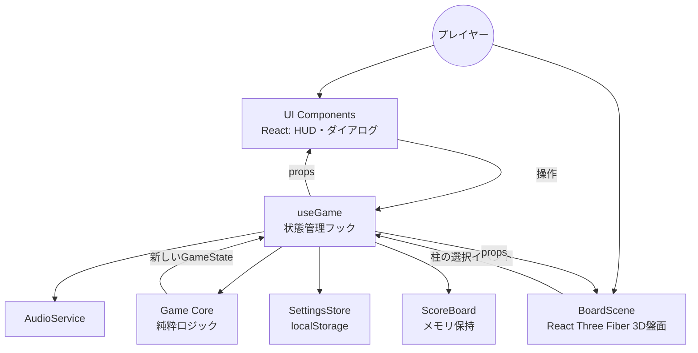
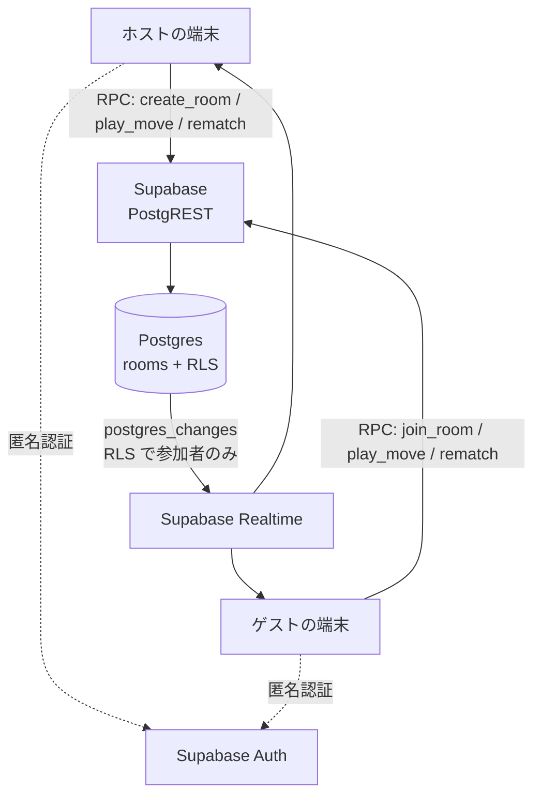

# Design Document

## Overview
3D コネクト フォーは、React + TypeScript 製のクライアント完結型Webアプリである。ゲームルールを描画から完全に分離した純粋ロジック層（`core`）を中心に、React Three Fiber による3D描画コンポーネント、React によるUIコンポーネント、Web Audio による音声層を、状態管理フック（`useGame`）で結合する構成とする。ゲーム状態とコマンドはシリアライズ可能な値として設計されており、オンライン対戦では、Supabase（匿名認証 + Postgres + Realtime）を使う。手番・重力・勝敗の検証はサーバー（SQL の関数）が行い、クライアントは表示と入力に徹する。詳細は「Online Play」を参照。

## Technology Stack（ユーザー合意事項。変更する場合は事前に相談すること）

| 用途 | 採用 | バージョン |
|---|---|---|
| 言語 | TypeScript（strict） | ^5.6 |
| ビルド・開発サーバー | Vite | ^6.0 |
| UI | react / react-dom | ^19.0 |
| 3D描画 | three | ^0.170.0 |
| React 用 3D 描画 | @react-three/fiber | ^9.0 |
| 3D 補助（カメラ操作 OrbitControls） | @react-three/drei | ^10.0 |
| テスト（単体・結合） | Vitest + jsdom + @testing-library/react | ^2.1 / ^16 |
| E2E テスト | Playwright | ^1.48 |
| 音声 | Web Audio API（ブラウザ標準。外部音源ファイルなし。合成音） | - |

- 状態管理は React 標準（`useReducer` / Context）とし、状態管理ライブラリは追加しない。
- ルーティングは不要（単一画面）。
- ランタイム依存は `react`, `react-dom`, `three`, `@react-three/fiber`, `@react-three/drei`, `@supabase/supabase-js` とする。
- オンライン対戦のために追加するライブラリ（ユーザー合意済み）:

| 用途 | 採用 | バージョン |
|---|---|---|
| Supabase クライアント（認証・RPC・Realtime） | @supabase/supabase-js | ^2（導入時の最新の2系を、ロックファイルで固定） |
| SQL の自動テスト（開発用のみ） | @electric-sql/pglite | 導入時の最新を、ロックファイルで固定 |

## Architecture

### High-Level Architecture


データフロー: 入力 → `useGame` が `core` に `Move` を適用 → 新しい `GameState` を受け取り → React の再描画で3D・UIに反映し、副作用として音声を再生する。`core` は React や three にも依存しない。

### System Components
| コンポーネント | 説明 | 対応要件 |
|---|---|---|
| Game Core | 盤面、手番、着手、勝敗・引き分け判定、取り消し | 2, 3, 5, 11 |
| useGame（フック） | 入力の受付、アニメーション中のロック、各層の調整 | 2, 4, 5 |
| BoardScene（React コンポーネント群） | 3D盤面・駒・カメラ・ハイライトの描画 | 1, 2, 3, 9 |
| Pillar コンポーネント | 柱の選択（R3F のポインタイベント）と、ドラッグとタップの判別 | 2 |
| UI Components | 手番表示、名前入力、ボタン、ダイアログ、遊び方 | 4, 5, 6, 8 |
| AudioService | 効果音の再生とオン・オフ | 7 |
| SettingsStore | 効果音設定の永続化 | 7, 10 |
| ScoreBoard | 通算成績の保持 | 5 |

## Components and Interfaces

### Core Interfaces
```ts
/** 0 または 1。先手を 0 とする */
export type PlayerId = 0 | 1;

/** 柱の位置。x, z はそれぞれ 0〜3 */
export interface PillarPos { x: number; z: number; }

/** 駒の位置。y は段（0 が最下段、3 が最上段） */
export interface CellPos extends PillarPos { y: number; }

/** 盤面。cells[x][z][y] に、置かれた駒の持ち主（空きは null）を保持する */
export type Cells = (PlayerId | null)[][][];

export interface Move {
  player: PlayerId;
  pillar: PillarPos;
  /** 落ちた先の位置（適用後に確定） */
  landed: CellPos;
}

export type GameStatus =
  | { kind: 'playing' }
  | { kind: 'won'; winner: PlayerId; lines: CellPos[][] }  // 同時成立は複数ライン
  | { kind: 'draw' };

/** イミュータブルな状態。JSON にシリアライズ可能（将来のオンライン対戦用） */
export interface GameState {
  readonly cells: Cells;
  readonly current: PlayerId;
  readonly history: readonly Move[];
  readonly status: GameStatus;
}

export type MoveError = 'PILLAR_FULL' | 'GAME_OVER' | 'OUT_OF_RANGE';

export type MoveResult =
  | { ok: true; state: GameState; move: Move }
  | { ok: false; error: MoveError };   // 失敗時、状態は変化しない

export interface PlayerSettings {
  names: [string, string];   // 最大12文字
  firstPlayer: PlayerId;
}

export interface Score { wins: [number, number]; draws: number; }

export interface PersistedSettings { soundEnabled: boolean; }
```

### Game Core（`src/core/`）
**Responsibilities:**
- 4×4×4 の盤面状態の管理（状態は不変。操作ごとに新しい状態を返す）
- 重力に従った着手と、不正操作の拒否
- 全76ラインによる勝敗判定、引き分け判定
- 1手戻す

**Key Methods:**
- `createGame(firstPlayer: PlayerId): GameState`
- `applyMove(state: GameState, pillar: PillarPos): MoveResult`
- `undo(state: GameState): GameState`（履歴が空なら同じ状態を返す）
- `getDropHeight(state: GameState, pillar: PillarPos): number | null`（満杯は null。プレビュー用）
- `checkResult(cells: Cells, last: CellPos): GameStatus`
- `WIN_LINES: readonly CellPos[][]`（起動時に1度だけ生成する、76ライン）

**ライン生成の内訳（計76）:** 軸方向 48（x・y・z 方向に各16）、平面上の斜め 24（3平面種 × 各4枚 × 2方向）、立体対角線 4。判定は「直近の着手を含むラインのみ」を確認し、毎手の計算量を最小にする。

### useGame フック（`src/app/useGame.ts`）
**Responsibilities:**
- `core` の状態を `useReducer` で唯一保持し、コンポーネントへ公開する
- 駒の落下アニメーション中、入力を受け付けない（`isAnimating` フラグ）
- 新規ゲーム、再戦（先後入れ替え）、取り消しの実行
- ゲーム終了時に ScoreBoard を更新し、副作用（`useEffect`）で効果音を再生する

**Key API（戻り値）:**
- `state: GameState` / `names` / `score: Score` / `isAnimating: boolean`
- `startGame(settings: PlayerSettings): void`
- `selectPillar(pillar: PillarPos): void`
- `undo(): void` / `restart(swapFirst: boolean): void`
- `onDropFinished(): void`（落下アニメーション終了時に BoardScene が呼ぶ）

### BoardScene（`src/render/`、React Three Fiber）
**Responsibilities:**
- `<Canvas>` 内に、土台、16本の `Pillar`、`Disc`（駒）、プレビュー用ゴースト駒を宣言的に描画する
- 駒の落下アニメーション（`useFrame`）、勝利ラインのハイライト、直前の駒の強調
- カメラ操作は drei の `OrbitControls`（回転・ズーム。距離と角度に制限をかけ、盤面全体が見える状態を維持）。視点リセットは `ref` 経由で実行する
- 先手と後手を色と形（例: 球と、くぼみ付きの円盤）の両方で区別する
- 「視覚効果を減らす」設定時は、落下やお祝い演出を簡略化する
- WebGL 非対応の検出

**Key Components / Props:**
- `<BoardScene state hoveredPillar lastMove winLines onSelect onHover onDropFinished resetSignal />`
- `<Pillar pos onSelect onHover />`
- `<Disc owner cell animate />`

### Pillar（柱の選択）
**Responsibilities:**
- R3F のポインタイベント（`onPointerOver` / `onClick`）で柱を特定する。柱は見た目より太い透明な当たり判定メッシュを持つ
- ポインタの移動量が閾値（例: 6px）未満のものだけを「選択」とし、それ以外は回転操作として無視する（R3F の `onClick` の `delta` を利用）

### UI Components（`src/ui/`、React）
**Responsibilities:**
- 開始前の名前入力（React が自動エスケープ。`dangerouslySetInnerHTML` は使用しない。最大12文字）
- 手番、手数、通算成績の表示、結果表示
- ボタン（新しいゲーム、1手戻す、視点リセット、効果音、遊び方）、確認ダイアログ
- 「遊び方」ダイアログ（勝利パターンの図は SVG で埋め込む）
- 満杯の柱を選んだ時の通知（トースト）
- レスポンシブ対応（最小幅360px）、タッチターゲットは 44px 以上

**Key Components:**
- `<Hud state names score />`、`<ResultDialog status names />`
- `<Toast message />`、`<HowToPlayDialog open />`、`<ConfirmDialog />`
- `<ControlBar onUndo onRestart onResetCamera onToggleSound />`、`<StartScreen onStart />`

### AudioService（`src/audio/`）
**Responsibilities:**
- Web Audio API による、着手音と勝利音の合成再生（音源ファイル不要）
- ブラウザの自動再生制限に対応し、最初のユーザー操作で AudioContext を開始する

**Key Methods:**
- `playDrop(): void` / `playWin(): void`
- `setEnabled(enabled: boolean): void`

### SettingsStore / ScoreBoard（`src/app/`）
**Responsibilities:**
- SettingsStore: `localStorage` へ効果音設定を保存・読込（アクセス不可でも動作を継続）
- ScoreBoard: 通算成績をメモリで保持（ページを閉じたら消える）

**Key Methods:**
- `SettingsStore.load(): PersistedSettings` / `save(s: PersistedSettings): void`
- `ScoreBoard.record(status: GameStatus): void` / `reset(): void`

## Online Play（オンライン対戦）

### 方針（決定事項）
| 項目 | 決定 |
|---|---|
| 識別 | Supabase の匿名認証（`signInAnonymously`）。端末ごとに `auth.uid()` が割り当てられる |
| 参加方法 | **招待リンク**（`https://<サイト>/?room=ABC234`）を、ホストが友人へ直接伝える。コードの手入力も可 |
| ルールの検証 | サーバー（Postgres の関数）。クライアントは、勝敗を申告できない |
| 同期 | Supabase Realtime（`postgres_changes`）。RPC の返り値でも、即座に反映する |
| 書き込み | RPC のみ。テーブルへの直接の INSERT / UPDATE / DELETE は、権限を与えない |
| 読み取り | RLS により、そのルームの参加者（ホスト・ゲスト）のみ |
| 鍵 | Publishable key のみ（クライアント）。秘密鍵は使わない |
| 対象外 | 1手戻す（オンライン）、AI対戦、ランダムマッチング、観戦、チャット |

### アーキテクチャ


クライアント内では、ローカル対戦と同じ `core`・`BoardScene`・`Hud` などを再利用する。オンライン専用なのは、通信層（`src/online/`）と、ロビー画面だけである。

### データモデル（Postgres）
手の履歴（`moves`）だけを保存し、盤面は、クライアントも `core` で再生して導く（サーバーの判定と同じルールで、同じ結果になることをテストで保証する）。

- **柱の番号** `p = x * 4 + z`（0〜15）。`moves` は、打たれた柱の番号を、順に並べた配列。
- **席（seat）**: 0 = ホスト、1 = ゲスト。`first_player` は、先手の席。i 手目（0始まり）を打つ席は、`(first_player + i) % 2`。
- クライアントの `PlayerId`（0 = 先手）と席の対応: `playerId = (seat - first_player + 2) % 2`。

```sql
-- supabase/migrations/20261122000000_online_rooms.sql（要約。実体はマイグレーションファイル）
create table public.rooms (
  id           uuid primary key default gen_random_uuid(),
  code         text not null unique check (code ~ '^[A-HJ-NP-Z2-9]{6}$'),
  host_id      uuid not null,
  guest_id     uuid,
  host_name    text not null check (char_length(host_name) between 1 and 12),
  guest_name   text check (char_length(guest_name) between 1 and 12),
  first_player smallint not null default 0 check (first_player in (0, 1)),
  moves        smallint[] not null default '{}' check (cardinality(moves) <= 64),
  status       text not null default 'waiting' check (status in ('waiting', 'playing', 'won', 'draw')),
  winner       smallint check (winner in (0, 1)),          -- 勝者の席
  host_wins    integer not null default 0,
  guest_wins   integer not null default 0,
  draws        integer not null default 0,
  created_at   timestamptz not null default now(),
  updated_at   timestamptz not null default now()
);

alter table public.rooms enable row level security;

-- 読み取り: 参加者のみ（匿名ユーザーも authenticated ロールのため、所有者の条件が必須）
create policy "participants can read" on public.rooms
  for select to authenticated
  using ((select auth.uid()) = host_id or (select auth.uid()) = guest_id);

-- 書き込みの権限は与えない（INSERT / UPDATE / DELETE は、RPC のみ）
revoke all on public.rooms from anon, authenticated;
grant select on public.rooms to authenticated;

alter publication supabase_realtime add table public.rooms;   -- Realtime
```

### RPC（`security definer` の関数）
`security definer` の関数は、公開 API になる（RLS を迂回する）ため、次を必ず守る。
- `set search_path = ''`、参照は、スキーマ名つきで書く。
- 関数の先頭で `auth.uid()` を確認する（NULL なら `NOT_AUTHENTICATED`）。
- `revoke execute ... from public, anon;` のうえで、`grant execute ... to authenticated;`。
- ロジックの本体（手の適用、勝敗判定）は、公開しない別スキーマ（`game_private`）に置く。

| 関数 | 内容 | 主なエラー（`raise exception` のメッセージ） |
|---|---|---|
| `create_room(p_name text)` | ルームを作成（コードを生成。衝突したら再試行）。ホストの席 0 | `INVALID_NAME` |
| `join_room(p_code text, p_name text)` | コードを正規化（大文字化・trim）して参加。すでに自分が参加者なら、そのまま返す（復帰）。参加が揃うと、`status = 'playing'` | `INVALID_NAME`, `ROOM_NOT_FOUND`, `ROOM_FULL` |
| `play_move(p_room_id uuid, p_pillar smallint)` | 行をロック（`for update`）し、参加者・進行中・手番・柱の範囲・満杯を検証。`moves` に追加し、勝敗を判定して、`status` / `winner` / 成績を更新 | `NOT_A_PLAYER`, `GAME_NOT_PLAYING`, `NOT_YOUR_TURN`, `INVALID_PILLAR`, `PILLAR_FULL` |
| `rematch(p_room_id uuid)` | 決着後のみ。参加者なら誰でも可。`first_player` を反転し、`moves` を空にして、`status = 'playing'` に戻す（成績は保持） | `NOT_A_PLAYER`, `GAME_NOT_FINISHED` |

返り値は、すべて更新後の `rooms` の行。クライアントは、これで即座に画面を更新する。

**勝敗判定（`game_private`）:** `cells_from_moves(moves)` で、64マスの配列（添字 `p*4 + y`、値は打った手の偶奇 = 先手側が 0）を作り、直近の着手のマスから、13方向について、前後に同じ値が続く数を数え、合計が 4 以上なら勝ち。64手で勝者なしなら、引き分け。`is_win(cells, last)` を、単体で検証できる関数として公開しない別スキーマに置く。

### クライアントの構成（`src/online/`）
```ts
/** サーバーの rooms の1行（スネークケースの列を、そのまま写す） */
export interface RoomRow {
  id: string; code: string;
  host_id: string; guest_id: string | null;
  host_name: string; guest_name: string | null;
  first_player: 0 | 1; moves: number[];
  status: 'waiting' | 'playing' | 'won' | 'draw';
  winner: 0 | 1 | null;
  host_wins: number; guest_wins: number; draws: number;
  updated_at: string;
}

export type RoomErrorCode =
  | 'NOT_CONFIGURED' | 'NOT_AUTHENTICATED' | 'INVALID_NAME' | 'ROOM_NOT_FOUND' | 'ROOM_FULL'
  | 'NOT_A_PLAYER' | 'GAME_NOT_PLAYING' | 'NOT_YOUR_TURN' | 'INVALID_PILLAR' | 'PILLAR_FULL'
  | 'GAME_NOT_FINISHED' | 'NETWORK' | 'UNKNOWN';

export type ConnectionState = 'connecting' | 'connected' | 'reconnecting' | 'disconnected';

/** 通信層。Supabase 実装と、テスト用の偽実装を差し替えられる */
export interface RoomApi {
  /** 現在のユーザー ID（匿名セッションがなければ作る） */
  ensureUser(): Promise<string>;
  createRoom(name: string): Promise<RoomRow>;
  joinRoom(code: string, name: string): Promise<RoomRow>;
  playMove(roomId: string, pillarIndex: number): Promise<RoomRow>;
  rematch(roomId: string): Promise<RoomRow>;
  getRoom(roomId: string): Promise<RoomRow | null>;
  subscribe(roomId: string, h: { onRow(row: RoomRow): void; onConnection(s: ConnectionState): void }): () => void;
}

/** 画面が使う形（席や先手の違いを吸収したもの） */
export interface OnlineView {
  state: GameState;                  // core で moves を再生した盤面
  mySeat: 0 | 1;
  myPlayerId: PlayerId;              // 自分の駒（0 = 先手）
  names: [string, string];           // PlayerId 順（先手の名前, 後手の名前）
  score: Score;                      // names と同じ順
  phase: 'waiting' | 'playing' | 'ended';
  isMyTurn: boolean;
}
```

| モジュール | 責務 |
|---|---|
| `supabaseClient.ts` | `createClient(url, publishableKey)`。環境変数がなければ、`null`（`isOnlineConfigured()` が false） |
| `SupabaseRoomApi.ts` | `RoomApi` の実装。RPC のエラーメッセージを、`RoomErrorCode` に変換する。Realtime のチャンネル状態を、`ConnectionState` に変換する |
| `roomLogic.ts`（純粋関数） | `rowToView(row, userId)`（`core` で再生。不正な履歴なら例外にせず、エラーとして扱う）、席と `PlayerId` の対応、`normalizeCode`、`toPillarIndex` / `fromPillarIndex` |
| `inviteLink.ts`（純粋関数） | `buildInviteUrl(origin, code)`、`parseInviteCode(search)` |
| `RoomStore.ts` | 参加中のルーム ID を、`localStorage`（`connect4-3d:online-room`）に保存・読込（再読み込み後の復帰用） |
| `useOnlineGame.ts` | 状態機械（下記）。`RoomApi` を受け取る（テストで偽実装を渡せる） |

**状態機械（`useOnlineGame`）:** `idle`（ロビー）→ `creating` / `joining` → `waiting`（ホストの待機）→ `playing` → `ended` →（再戦で）`playing`。どの状態からも `error`（メッセージつき）へ、`leave()` で `idle` へ遷移する。

**同期の規則:**
- 行（`RoomRow`）を受け取ったとき、`moves` の長さが、手元より短い、または同じなら無視する（RPC の返り値と Realtime の重複、順序の逆転への対策）。再戦で `moves` が短くなる場合だけは、`first_player` / `status` の変化で判別して受け入れる。
- 手が**ちょうど1手**増えたときだけ、落下アニメーションを再生する。それ以外（復帰時の同期など）は、アニメーションなしで、最新の盤面にする。
- 着手: 自分の手番でなければ、送信せずに「相手の手番です」を通知する。送信中は、二重送信を防ぐ。
- 再接続: チャンネルが `SUBSCRIBED` に戻ったら、`getRoom` で最新の行を取得して、同期する。

### UI
- **開始画面（`StartScreen`）**: 「ローカル対戦」「オンライン対戦」の選択を追加する。接続設定がなければ、オンラインは無効（理由を表示）。
- **`OnlineLobby`**: 表示名の入力、「ルームを作る」、コード入力での参加。`?room=CODE` つきで開いたときは、コード入力済みの「参加」画面になる。
- **`WaitingRoom`**: 招待リンクの表示と「招待リンクをコピー」、ルームコード、待機中の表示、「やめる」。
- **対局画面**: 既存の `Hud` / `BoardScene` / `ResultDialog` / `Toast` / `Celebration` を再利用する。追加するのは、`OnlineBar`（自分・相手の名前と駒の見た目、「あなたの番 / 相手の番」、接続状態、「ルームを抜ける」）。`ControlBar` は、「1手戻す」「新しいゲーム」を隠す（`mode="online"`）。
- 再戦は、`ResultDialog` の「もう一度遊ぶ」から `rematch` を呼ぶ（先手と後手の入れ替えは、サーバーが自動で行うため、チェックボックスは非表示）。

### 設定とセキュリティ
- 環境変数: `VITE_SUPABASE_URL`、`VITE_SUPABASE_PUBLISHABLE_KEY`。`.env.local`（Git 管理外）と、Vercel の Environment Variables に設定する。`.env.example` をリポジトリに含める。
- **CSP**: ビルド時に、`VITE_SUPABASE_URL` から、ホスト名を取り出して、`connect-src 'self' https://<ref>.supabase.co wss://<ref>.supabase.co` とする。環境変数がなければ、従来どおり `'self'` のみ。
- 表示名は、React の自動エスケープで表示する（`dangerouslySetInnerHTML` は使わない）。サーバー側でも、長さを検証する。
- 運用: 古いルームの削除は、初期版では行わない（必要になれば、`pg_cron` で定期削除する）。匿名サインインの濫用は、Supabase Auth のレート制限に任せる。
- リポジトリに含めない: `service_role` / secret key、`.env.local`。方針テストで、`service_role` の文字列がソースに含まれないことを検査する。

### Supabase ダッシュボードでの設定（ユーザー作業）
1. Authentication → Sign In / Providers で、**Allow anonymous sign-ins** を有効にする。
2. SQL Editor で、`supabase/migrations/20261122000000_online_rooms.sql` の内容を実行する。
3. Database → Publications（または SQL）で、`rooms` が `supabase_realtime` に含まれていることを確認する（マイグレーションが追加する）。
4. Project URL と Publishable key を、`.env.local` と Vercel の環境変数に設定する。

## Data Models

### Database Schema
**ローカル対戦:** 該当なし。データベースは使わない。ブラウザに保存するのは、効果音設定（`localStorage` のキー `connect4-3d:settings`）のみ。

**オンライン対戦:** Supabase の Postgres に、`public.rooms` テーブルを置く（定義は「Online Play」を参照）。ブラウザには、これに加えて、匿名認証のセッション（supabase-js が `localStorage` に保存）と、参加中のルーム ID（`connect4-3d:online-room`）を保存する。

オンライン対戦のスキーマは、`GameState` / `Move` の考え方（手の履歴から盤面を導く）を踏襲している。

### File Storage Structure
```
lesson_app/
├── requirements.md / design.md / task.md
├── CLAUDE.md
├── README.md                 # 要件12.2: 構築・起動・テスト・ビルド手順
├── package.json
├── tsconfig.json
├── vite.config.ts
├── index.html
├── supabase/
│   └── migrations/           # オンライン対戦の SQL（テーブル・RLS・RPC・Realtime）
├── .env.example              # 環境変数の見本（実際の値は .env.local。Git 管理外）
├── src/
│   ├── core/                 # 純粋ロジック（three や DOM に依存しない）
│   │   ├── types.ts
│   │   ├── lines.ts          # 76ライン生成
│   │   ├── game.ts           # createGame / applyMove / undo / checkResult
│   │   └── index.ts
│   ├── app/                  # useGame, SettingsStore, ScoreBoard, App.tsx
│   ├── render/               # BoardScene, Pillar, Disc（React Three Fiber）
│   ├── ui/                   # HUD, ダイアログ, 遊び方（React コンポーネント）
│   ├── online/               # オンライン対戦（RoomApi, SupabaseRoomApi, roomLogic, inviteLink, RoomStore, useOnlineGame）
│   ├── audio/                # AudioService
│   ├── styles/
│   └── main.tsx
├── tests/
│   ├── unit/                 # core, app の単体テスト
│   ├── integration/          # controller + jsdom
│   └── e2e/                  # Playwright
└── dist/                     # ビルド成果物（静的ホスティング用）
```

## Error Handling
| 種別 | 事象 | 対処 |
|---|---|---|
| ユーザー入力 | 満杯の柱を選択 | `core` が `PILLAR_FULL` を返し、状態不変。UIが「この柱は満杯です」と通知 |
| ユーザー入力 | ゲーム終了後・アニメーション中の入力 | 無視する（`GAME_OVER` を返す、またはコントローラ側でロック） |
| ユーザー入力 | 名前が空・12文字超 | 空は既定名、超過は切り詰める。HTML は一切解釈しない（`textContent`） |
| 環境 | WebGL 非対応 | 日本語の案内文を表示し、ゲームは開始しない |
| 環境 | `localStorage` 不可 | 例外を握りつぶし、メモリ上の既定値で動作を継続する |
| 環境 | `AudioContext` 不可・停止 | 無音で継続する（ゲーム進行に影響させない） |
| 内部 | 想定外の例外 | 画面に「問題が発生しました。新しいゲームを開始してください」を出し、コンソールに記録する。盤面状態は不変のまま保つ |

`core` は例外を投げず、`MoveResult` で結果を返す。

### Error Handling（オンライン対戦）
| 事象 | 対処 |
|---|---|
| 接続設定がない | オンラインを無効にし、理由を表示。ローカル対戦は影響なし |
| 匿名認証に失敗 | 「接続に失敗しました。時間をおいて再度お試しください」。再試行ボタン |
| ルームが存在しない / 満員 | 日本語のメッセージで、ロビーに戻す |
| 相手の手番で着手 | 送信せず、「相手の手番です」を通知 |
| 着手の送信に失敗（通信エラー） | 盤面は変えず、「送信に失敗しました。もう一度選んでください」を通知 |
| Realtime が切断 | 「再接続中…」を表示し、自動で再接続。復帰時に `getRoom` で同期 |
| サーバーが返した履歴が不正（再生に失敗） | 例外にせず、エラー画面（ルームを抜ける導線つき）を表示 |
| 再読み込み | 保存したルーム ID から、`getRoom` で復帰。取得できなければ（参加者でなければ）、保存を消してロビーへ |

## Testing Strategy

### 単体テスト（Vitest）
- **ライン生成:** 総数が76、軸48・平面斜め24・立体対角線4、重複がないこと。
- **勝敗判定:** 76ラインのそれぞれで、4連続が勝ちになること（全ライン網羅）。3連続や相手の駒が混じる場合は勝ちにならない。同時成立で複数ラインが返る。
- **着手:** 駒が最下段から積まれること、満杯の柱が `PILLAR_FULL` になること、終了後の着手が `GAME_OVER` になり状態が不変であること。
- **引き分け:** 64マスが勝者なしで埋まった場合のみ `draw` になること。
- **取り消し:** 着手と取り消しで元に戻ること、連続して最初まで戻れること、終了状態からも戻せること。
- **状態の不変性:** 入力した状態が書き換わらないこと。
- **SettingsStore / ScoreBoard / 名前の正規化:** 保存と読込、アクセス不可時、12文字の上限。

### 結合テスト（Vitest + jsdom）
- `useGame`（`renderHook`）と UI コンポーネント（`@testing-library/react`）で、一連のゲーム（選択 → 着手 → 勝利 → 再戦 → 先後入れ替え）を流し、HUD表示、手番、成績が期待どおりになること。
- アニメーション中の入力が無視されること（3D 描画は jsdom で動かないため、`BoardScene` はモックに差し替える）。
- 効果音のオン・オフと保存の連動。

### E2E テスト（Playwright）
- 柱のクリックで駒が置かれ、手番が切り替わること。
- ドラッグ（回転）が着手として扱われないこと。
- 勝利・引き分けの表示、新しいゲームの確認ダイアログ、1手戻す。
- 幅360px と デスクトップで、盤面とボタンが収まること。

### パフォーマンステスト
- `applyMove` を 64手の全パターン相当で繰り返し、1手あたり 100ms 未満（実際はごく小さい値）であることをベンチマークで確認する。
- ブラウザの計測（Playwright + Performance API）で、回転と落下中の平均フレームレートが 30fps 以上であること。
- ビルド成果物のサイズを確認し、初回表示が数秒以内となる範囲に収める。
- 負荷（多数ユーザー）テストは、サーバーがないため対象外とする。

### オンライン対戦のテスト

**SQL の自動テスト（Vitest + PGlite）**
- マイグレーションの SQL を、PGlite（WASM の Postgres）で実行する。Supabase 固有のもの（`auth.uid()`、`anon` / `authenticated` ロール）は、テスト用の代用品を用意し、`request.jwt.claim.sub` で、ユーザーを切り替える。
- 勝敗判定: `game_private.is_win` に、`core` の `WIN_LINES`（全76ライン）を与え、すべて勝ちになること。3連続・相手の駒の混在は、勝ちにならないこと（`core` と同じ結果）。
- `play_move`: 手番の検証、重力（柱の積み上がり）、満杯の拒否、範囲外の拒否、終了後の拒否。勝利で `status` / `winner` / 成績が更新されること。64手で引き分けになること（`core` のテストと同じ配置）。
- `join_room`: 満員、存在しないコード、コードの正規化（小文字・空白）、同じユーザーの再参加が復帰になること。
- `rematch`: 決着後のみ可能。先手が入れ替わり、手の履歴が空になり、成績が保持されること。
- 権限（RLS）: 他人のルームは、SELECT しても 0 行。`insert` / `update` / `delete` の直接実行は、拒否される。他人は、`play_move` / `rematch` を呼べない。`anon` ロールは、関数を実行できない。

**単体テスト**
- `roomLogic`: 席と `PlayerId` の対応（先手がホスト / ゲストの両方）、`moves` からの盤面の再生、`isMyTurn`、不正な履歴の扱い、`normalizeCode`、柱の番号の変換。
- `inviteLink`: 招待リンクの生成と解析（不正な値は無視）。
- `SupabaseRoomApi`: Supabase クライアントを偽物に差し替え、RPC のエラーメッセージ → `RoomErrorCode` の変換、Realtime のチャンネル状態 → `ConnectionState` の変換。
- `RoomStore`、環境変数がない場合の `isOnlineConfigured`。

**結合テスト（偽の `RoomApi`）**
- `useOnlineGame`: 作成 → 待機 → 相手の参加 → 着手 → 決着 → 再戦、の一連。重複した行（RPC の返り値と Realtime）の無視、1手増えた場合のみアニメーション、再接続時の同期、相手の手番での着手の拒否、エラー時の遷移。
- 画面: ロビー、待機画面（コピー）、対局画面（オンライン用のバー、「1手戻す」が出ないこと）。

**方針テストの更新**
- 通信・保存先の API を使ってよい場所を、`src/online/`（と、既存の `SettingsStore`）に限定する。`service_role` / `secret` の文字列が、ソースに含まれないこと。`.env.local` が、`.gitignore` に含まれること。

**E2E（Playwright、任意）**
- Supabase の実プロジェクトに接続し、2つのブラウザコンテキストで、ルーム作成 → 招待リンクで参加 → 交互に着手 → 決着 → 再戦、を通す。環境変数（`VITE_SUPABASE_URL` など）が設定されている場合のみ実行し、なければスキップする。通常の `npm run test:e2e` には影響しない。

