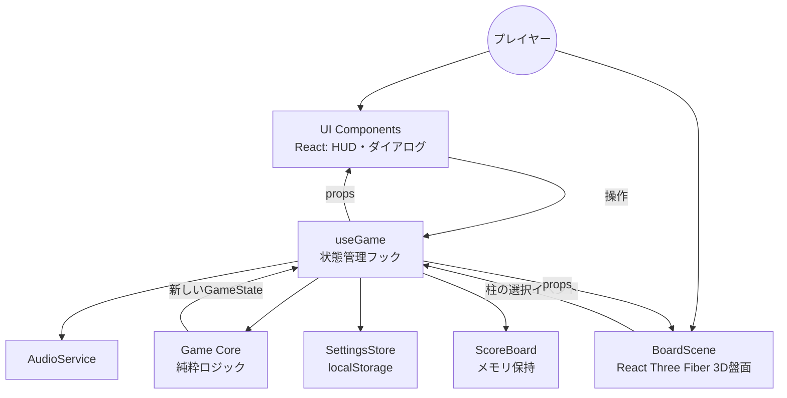

# Design Document

## Overview
3D コネクト フォーは、React + TypeScript 製のクライアント完結型Webアプリである。ゲームルールを描画から完全に分離した純粋ロジック層（`core`）を中心に、React Three Fiber による3D描画コンポーネント、React によるUIコンポーネント、Web Audio による音声層を、状態管理フック（`useGame`）で結合する構成とする。将来のオンライン対戦に備え、ゲーム状態とコマンドをシリアライズ可能な値として設計する。

## Technology Stack（ユーザー合意事項。変更する場合は事前に相談すること）

| 用途 | 採用 | バージョン |
|---|---|---|
| 言語 | TypeScript（strict） | ^5.6 |
| ビルド・開発サーバー | Vite | ^6.0 |
| UI | react / react-dom | ^19.0 |
| 3D描画 | three | ^0.170.0 |
| React 用 3D 描画 | @react-three/fiber | ^9.0 |
| 3D 補助（カメラ操作 OrbitControls） | @react-three/drei | ^10.0 |
| テスト（単体・結合） | Vitest + jsdom + @testing-library/react | ^2.1 / ^16 |
| E2E テスト | Playwright | ^1.48 |
| 音声 | Web Audio API（ブラウザ標準。外部音源ファイルなし。合成音） | - |

- 状態管理は React 標準（`useReducer` / Context）とし、状態管理ライブラリは追加しない。
- ルーティングは不要（単一画面）。
- ランタイム依存は `react`, `react-dom`, `three`, `@react-three/fiber`, `@react-three/drei` とする。

## Architecture

### High-Level Architecture


データフロー: 入力 → `useGame` が `core` に `Move` を適用 → 新しい `GameState` を受け取り → React の再描画で3D・UIに反映し、副作用として音声を再生する。`core` は React や three にも依存しない。

### System Components
| コンポーネント | 説明 | 対応要件 |
|---|---|---|
| Game Core | 盤面、手番、着手、勝敗・引き分け判定、取り消し | 2, 3, 5, 11 |
| useGame（フック） | 入力の受付、アニメーション中のロック、各層の調整 | 2, 4, 5 |
| BoardScene（React コンポーネント群） | 3D盤面・駒・カメラ・ハイライトの描画 | 1, 2, 3, 9 |
| Pillar コンポーネント | 柱の選択（R3F のポインタイベント）と、ドラッグとタップの判別 | 2 |
| UI Components | 手番表示、名前入力、ボタン、ダイアログ、遊び方 | 4, 5, 6, 8 |
| AudioService | 効果音の再生とオン・オフ | 7 |
| SettingsStore | 効果音設定の永続化 | 7, 10 |
| ScoreBoard | 通算成績の保持 | 5 |

## Components and Interfaces

### Core Interfaces
```ts
/** 0 または 1。先手を 0 とする */
export type PlayerId = 0 | 1;

/** 柱の位置。x, z はそれぞれ 0〜3 */
export interface PillarPos { x: number; z: number; }

/** 駒の位置。y は段（0 が最下段、3 が最上段） */
export interface CellPos extends PillarPos { y: number; }

/** 盤面。cells[x][z][y] に、置かれた駒の持ち主（空きは null）を保持する */
export type Cells = (PlayerId | null)[][][];

export interface Move {
  player: PlayerId;
  pillar: PillarPos;
  /** 落ちた先の位置（適用後に確定） */
  landed: CellPos;
}

export type GameStatus =
  | { kind: 'playing' }
  | { kind: 'won'; winner: PlayerId; lines: CellPos[][] }  // 同時成立は複数ライン
  | { kind: 'draw' };

/** イミュータブルな状態。JSON にシリアライズ可能（将来のオンライン対戦用） */
export interface GameState {
  readonly cells: Cells;
  readonly current: PlayerId;
  readonly history: readonly Move[];
  readonly status: GameStatus;
}

export type MoveError = 'PILLAR_FULL' | 'GAME_OVER' | 'OUT_OF_RANGE';

export type MoveResult =
  | { ok: true; state: GameState; move: Move }
  | { ok: false; error: MoveError };   // 失敗時、状態は変化しない

export interface PlayerSettings {
  names: [string, string];   // 最大12文字
  firstPlayer: PlayerId;
}

export interface Score { wins: [number, number]; draws: number; }

export interface PersistedSettings { soundEnabled: boolean; }
```

### Game Core（`src/core/`）
**Responsibilities:**
- 4×4×4 の盤面状態の管理（状態は不変。操作ごとに新しい状態を返す）
- 重力に従った着手と、不正操作の拒否
- 全76ラインによる勝敗判定、引き分け判定
- 1手戻す

**Key Methods:**
- `createGame(firstPlayer: PlayerId): GameState`
- `applyMove(state: GameState, pillar: PillarPos): MoveResult`
- `undo(state: GameState): GameState`（履歴が空なら同じ状態を返す）
- `getDropHeight(state: GameState, pillar: PillarPos): number | null`（満杯は null。プレビュー用）
- `checkResult(cells: Cells, last: CellPos): GameStatus`
- `WIN_LINES: readonly CellPos[][]`（起動時に1度だけ生成する、76ライン）

**ライン生成の内訳（計76）:** 軸方向 48（x・y・z 方向に各16）、平面上の斜め 24（3平面種 × 各4枚 × 2方向）、立体対角線 4。判定は「直近の着手を含むラインのみ」を確認し、毎手の計算量を最小にする。

### useGame フック（`src/app/useGame.ts`）
**Responsibilities:**
- `core` の状態を `useReducer` で唯一保持し、コンポーネントへ公開する
- 駒の落下アニメーション中、入力を受け付けない（`isAnimating` フラグ）
- 新規ゲーム、再戦（先後入れ替え）、取り消しの実行
- ゲーム終了時に ScoreBoard を更新し、副作用（`useEffect`）で効果音を再生する

**Key API（戻り値）:**
- `state: GameState` / `names` / `score: Score` / `isAnimating: boolean`
- `startGame(settings: PlayerSettings): void`
- `selectPillar(pillar: PillarPos): void`
- `undo(): void` / `restart(swapFirst: boolean): void`
- `onDropFinished(): void`（落下アニメーション終了時に BoardScene が呼ぶ）

### BoardScene（`src/render/`、React Three Fiber）
**Responsibilities:**
- `<Canvas>` 内に、土台、16本の `Pillar`、`Disc`（駒）、プレビュー用ゴースト駒を宣言的に描画する
- 駒の落下アニメーション（`useFrame`）、勝利ラインのハイライト、直前の駒の強調
- カメラ操作は drei の `OrbitControls`（回転・ズーム。距離と角度に制限をかけ、盤面全体が見える状態を維持）。視点リセットは `ref` 経由で実行する
- 先手と後手を色と形（例: 球と、くぼみ付きの円盤）の両方で区別する
- 「視覚効果を減らす」設定時は、落下やお祝い演出を簡略化する
- WebGL 非対応の検出

**Key Components / Props:**
- `<BoardScene state hoveredPillar lastMove winLines onSelect onHover onDropFinished resetSignal />`
- `<Pillar pos onSelect onHover />`
- `<Disc owner cell animate />`

### Pillar（柱の選択）
**Responsibilities:**
- R3F のポインタイベント（`onPointerOver` / `onClick`）で柱を特定する。柱は見た目より太い透明な当たり判定メッシュを持つ
- ポインタの移動量が閾値（例: 6px）未満のものだけを「選択」とし、それ以外は回転操作として無視する（R3F の `onClick` の `delta` を利用）

### UI Components（`src/ui/`、React）
**Responsibilities:**
- 開始前の名前入力（React が自動エスケープ。`dangerouslySetInnerHTML` は使用しない。最大12文字）
- 手番、手数、通算成績の表示、結果表示
- ボタン（新しいゲーム、1手戻す、視点リセット、効果音、遊び方）、確認ダイアログ
- 「遊び方」ダイアログ（勝利パターンの図は SVG で埋め込む）
- 満杯の柱を選んだ時の通知（トースト）
- レスポンシブ対応（最小幅360px）、タッチターゲットは 44px 以上

**Key Components:**
- `<Hud state names score />`、`<ResultDialog status names />`
- `<Toast message />`、`<HowToPlayDialog open />`、`<ConfirmDialog />`
- `<ControlBar onUndo onRestart onResetCamera onToggleSound />`、`<StartScreen onStart />`

### AudioService（`src/audio/`）
**Responsibilities:**
- Web Audio API による、着手音と勝利音の合成再生（音源ファイル不要）
- ブラウザの自動再生制限に対応し、最初のユーザー操作で AudioContext を開始する

**Key Methods:**
- `playDrop(): void` / `playWin(): void`
- `setEnabled(enabled: boolean): void`

### SettingsStore / ScoreBoard（`src/app/`）
**Responsibilities:**
- SettingsStore: `localStorage` へ効果音設定を保存・読込（アクセス不可でも動作を継続）
- ScoreBoard: 通算成績をメモリで保持（ページを閉じたら消える）

**Key Methods:**
- `SettingsStore.load(): PersistedSettings` / `save(s: PersistedSettings): void`
- `ScoreBoard.record(status: GameStatus): void` / `reset(): void`

## Data Models

### Database Schema
**該当なし。** 本アプリはサーバーとデータベースを持たない（要件10）。保存するデータは、効果音設定のみで、`localStorage` のキー `connect4-3d:settings` に JSON で保存する。

将来オンライン対戦を導入する場合は、`GameState` と `Move`（JSON化可能）をそのままサーバーとのやり取りに使い、この時点でスキーマを設計する。

### File Storage Structure
```
lesson_app/
├── requirements.md / design.md / task.md
├── CLAUDE.md
├── README.md                 # 要件12.2: 構築・起動・テスト・ビルド手順
├── package.json
├── tsconfig.json
├── vite.config.ts
├── index.html
├── src/
│   ├── core/                 # 純粋ロジック（three や DOM に依存しない）
│   │   ├── types.ts
│   │   ├── lines.ts          # 76ライン生成
│   │   ├── game.ts           # createGame / applyMove / undo / checkResult
│   │   └── index.ts
│   ├── app/                  # useGame, SettingsStore, ScoreBoard, App.tsx
│   ├── render/               # BoardScene, Pillar, Disc（React Three Fiber）
│   ├── ui/                   # HUD, ダイアログ, 遊び方（React コンポーネント）
│   ├── audio/                # AudioService
│   ├── styles/
│   └── main.tsx
├── tests/
│   ├── unit/                 # core, app の単体テスト
│   ├── integration/          # controller + jsdom
│   └── e2e/                  # Playwright
└── dist/                     # ビルド成果物（静的ホスティング用）
```

## Error Handling
| 種別 | 事象 | 対処 |
|---|---|---|
| ユーザー入力 | 満杯の柱を選択 | `core` が `PILLAR_FULL` を返し、状態不変。UIが「この柱は満杯です」と通知 |
| ユーザー入力 | ゲーム終了後・アニメーション中の入力 | 無視する（`GAME_OVER` を返す、またはコントローラ側でロック） |
| ユーザー入力 | 名前が空・12文字超 | 空は既定名、超過は切り詰める。HTML は一切解釈しない（`textContent`） |
| 環境 | WebGL 非対応 | 日本語の案内文を表示し、ゲームは開始しない |
| 環境 | `localStorage` 不可 | 例外を握りつぶし、メモリ上の既定値で動作を継続する |
| 環境 | `AudioContext` 不可・停止 | 無音で継続する（ゲーム進行に影響させない） |
| 内部 | 想定外の例外 | 画面に「問題が発生しました。新しいゲームを開始してください」を出し、コンソールに記録する。盤面状態は不変のまま保つ |

`core` は例外を投げず、`MoveResult` で結果を返す。

## Testing Strategy

### 単体テスト（Vitest）
- **ライン生成:** 総数が76、軸48・平面斜め24・立体対角線4、重複がないこと。
- **勝敗判定:** 76ラインのそれぞれで、4連続が勝ちになること（全ライン網羅）。3連続や相手の駒が混じる場合は勝ちにならない。同時成立で複数ラインが返る。
- **着手:** 駒が最下段から積まれること、満杯の柱が `PILLAR_FULL` になること、終了後の着手が `GAME_OVER` になり状態が不変であること。
- **引き分け:** 64マスが勝者なしで埋まった場合のみ `draw` になること。
- **取り消し:** 着手と取り消しで元に戻ること、連続して最初まで戻れること、終了状態からも戻せること。
- **状態の不変性:** 入力した状態が書き換わらないこと。
- **SettingsStore / ScoreBoard / 名前の正規化:** 保存と読込、アクセス不可時、12文字の上限。

### 結合テスト（Vitest + jsdom）
- `useGame`（`renderHook`）と UI コンポーネント（`@testing-library/react`）で、一連のゲーム（選択 → 着手 → 勝利 → 再戦 → 先後入れ替え）を流し、HUD表示、手番、成績が期待どおりになること。
- アニメーション中の入力が無視されること（3D 描画は jsdom で動かないため、`BoardScene` はモックに差し替える）。
- 効果音のオン・オフと保存の連動。

### E2E テスト（Playwright）
- 柱のクリックで駒が置かれ、手番が切り替わること。
- ドラッグ（回転）が着手として扱われないこと。
- 勝利・引き分けの表示、新しいゲームの確認ダイアログ、1手戻す。
- 幅360px と デスクトップで、盤面とボタンが収まること。

### パフォーマンステスト
- `applyMove` を 64手の全パターン相当で繰り返し、1手あたり 100ms 未満（実際はごく小さい値）であることをベンチマークで確認する。
- ブラウザの計測（Playwright + Performance API）で、回転と落下中の平均フレームレートが 30fps 以上であること。
- ビルド成果物のサイズを確認し、初回表示が数秒以内となる範囲に収める。
- 負荷（多数ユーザー）テストは、サーバーがないため対象外とする。
